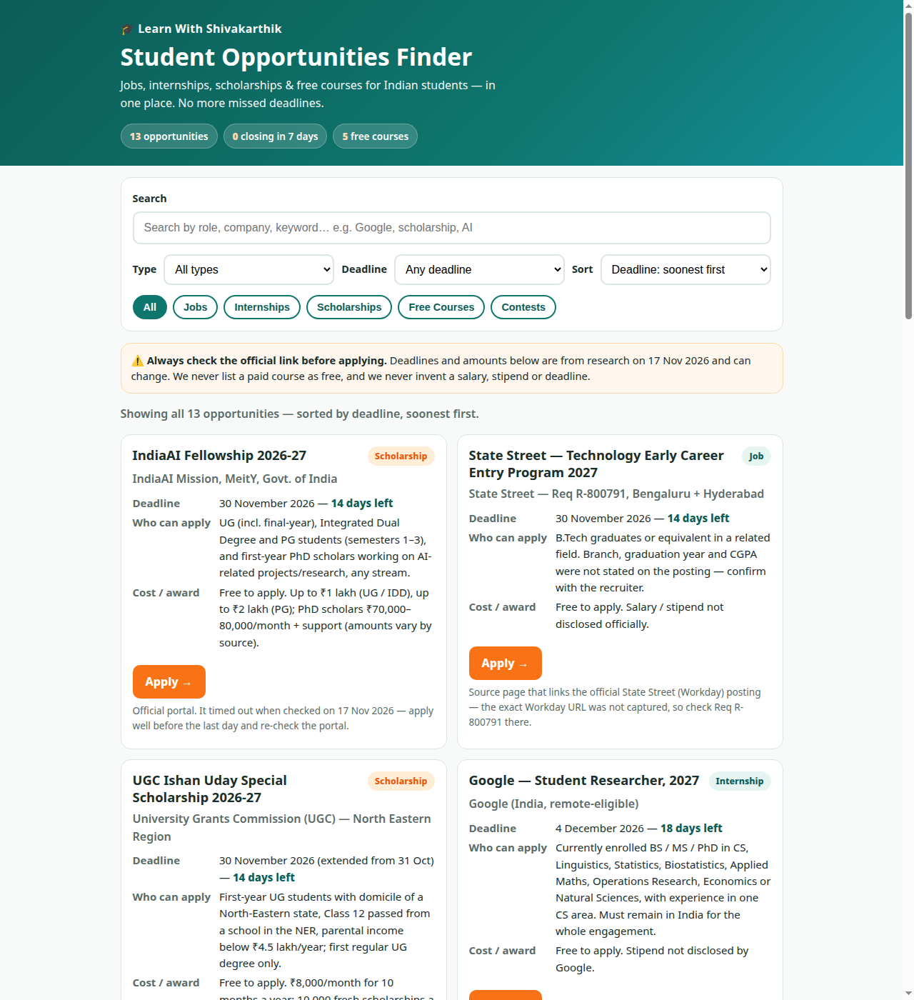
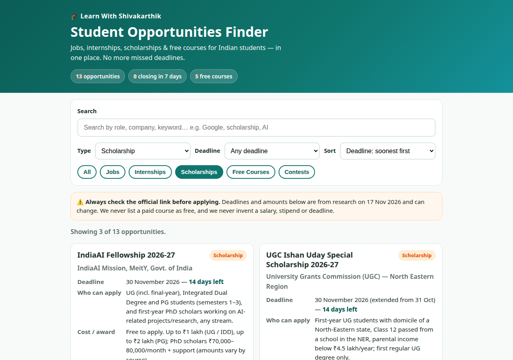

# Student Opportunities Finder

**By Learn With Shivakarthik — Pendyala Shivakarthik**

A simple, mobile-friendly web app that puts jobs, internships, scholarships and free courses for Indian students in **one place**, with deadlines, eligibility and verified apply links.

> Live data is in `app.js`. No build step, no framework, no server — just open `index.html`.

---

## The problem it solves

Student opportunities in India are scattered across many sites. That causes real problems:

1. **Deadlines are missed** — a great internship or scholarship closes before a student even hears about it.
2. **Eligibility is unclear** — students waste time on roles they cannot apply for.
3. **Expired and paid links are mixed in with free ones** — a paid test or a paid course is shown as if it were free, and closed scholarships are shown as open.
4. **Salaries and deadlines get invented** — aggregator posts guess at stipends and dates, so students apply with wrong information.

This app fixes those drawbacks:

- **One list, not ten tabs** — 13 real opportunities in one searchable list.
- **Deadlines first** — sorted by deadline, soonest first, with a live "days left" countdown.
- **Eligibility up front** — check if you can apply before you click Apply.
- **Free means free** — paid exams and fees are flagged, never hidden. TCS NQT (fees from ₹599) is not listed as a free opportunity.
- **No invented numbers** — where a salary or stipend was not disclosed officially, the card says so. Where no deadline was published, it says so.
- **Verified links only** — every Apply button goes to the official page, or to the source page that carries the official apply link (and the card says which).

---

## Features

- 🔍 **Search** — by role, company or keyword (e.g. "Google", "scholarship", "AI")
- 🏷️ **Filter by type** — Job / Internship / Scholarship / Free Course / Coding Contest
- ⏰ **Filter by deadline** — closing in 7 days, closing in 30 days, or no deadline published
- 📅 **Sort** — deadline soonest first (default), or name A–Z
- ⏳ **Days-left countdown** — computed live from today's date; cards closing soon are highlighted in orange
- 📱 **Mobile-first** — designed for a phone, since many students only have a mobile
- 🎨 **Learn With Shivakarthik branding** — clean teal + orange design

---

## Opportunities included

Data last checked: **17 November 2026**. All 13 items below are from the research report — no other items were added, and no salary, deadline or link was invented.

| # | Opportunity | Type | Deadline |
|---|-------------|------|----------|
| 1 | Google — Student Researcher, 2027 | Internship | 4 Dec 2026 |
| 2 | Amazon — SDE Intern, Jan 2027 (Job ID 10517894) | Internship | No deadline published — rolling |
| 3 | State Street — Technology Early Career Entry Program 2027 (Req R-800791) | Job | 30 Nov 2026 |
| 4 | Google — Forward Deployed Engineer Intern, 2027 | Internship | No deadline published |
| 5 | IndiaAI Fellowship 2026-27 | Scholarship | 30 Nov 2026 |
| 6 | UGC Ishan Uday Special Scholarship 2026-27 | Scholarship | 30 Nov 2026 |
| 7 | Commonwealth Shared Scholarships 2027 | Scholarship | 8 Dec 2026, 16:00 GMT |
| 8 | TCS CodeVita Season 14 | Coding Contest | No closing date published |
| 9 | Google Skills — Introduction to Generative AI | Free Course | Always open |
| 10 | IBM SkillsBuild — AI Fundamentals | Free Course | Always open |
| 11 | AWS Skill Builder + AWS Educate | Free Course | Always open |
| 12 | Microsoft Learn — AI learning paths | Free Course | Always open |
| 13 | Salesforce Trailhead | Free Course | Always open |

### Deliberately NOT included

- **Amazon Future Engineer Scholarship (India)** — applications are currently closed in India and will reopen in 2027, with no exact date announced. It must not be shown as open or as "apply by 30 Nov".
- **TCS NQT Dec 2026** — a paid test (fees from ₹599), not a free application. It is excluded rather than listed as free.

### Notes on the data

- **IndiaAI Fellowship:** one tracker lists 23 Dec, but 8+ sources back 30 Nov 2026. The app uses 30 Nov and the card tells you to re-check the portal.
- **UGC Ishan Uday:** the amount in the research report is ₹8,000/month for 10 months; other sources list different figures, so the card says "check NSP for the current figure".
- **State Street / Google Forward Deployed Engineer Intern / TCS CodeVita:** no exact official apply URL was captured in the research, so the Apply button links to the source page that carries the official apply link, and the card says so. Do not guess a Workday URL.
- **Free courses:** training and badges are free; formal certification exams are paid where stated (AWS, Microsoft AI-901, Salesforce ~$200). Those costs are shown on the card.

---

## How to run locally

No installation, no build step, no server needed.

1. Download / clone this folder.
2. Open `index.html` in any browser (phone or computer).
3. That's it — search, filter and sort work offline. The Apply links need the internet.

---

## Project structure

```
student-opportunities-finder/
├── index.html          # Page structure: header, search/filters, cards, about, footer
├── styles.css          # Teal/orange, mobile-first styling (no framework)
├── app.js              # All opportunity data + search, filter, sort, days-left logic
├── README.md           # This file
└── screenshots/        # Screenshots of the live site (see below)
```

To add a new opportunity, add one object to the `OPPORTUNITIES` array in `app.js` — title, provider, type, deadline (`"YYYY-MM-DD"` or `null`), deadlineText, eligibility, cost, link and linkNote. The search, filters, sort and countdown pick it up automatically.

---

## Screenshots





- `screenshots/home.png` — homepage with all opportunities, sorted by deadline
- `screenshots/filters.png` — Scholarships filter in use, showing 3 of 13 opportunities

Captured 17 Nov 2026 in a real browser from `index.html`.

---

## Data sources

Research report: `~/workspace/research_notes/student-jobs-free-courses-india-20261117-0024/report.md` (17 Nov 2026).

- Google Careers — Student Researcher 2027 (verified live)
- amazon.jobs — SDE Intern Jan 2027, Job ID 10517894
- Freshershunt — State Street, Google Forward Deployed Engineer Intern, TCS CodeVita
- IndiaAI Fellowship portal — https://fellowship.indiaai.gov.in/
- National Scholarship Portal — https://scholarships.gov.in
- Commonwealth Shared Scholarships — University of Glasgow / CSC
- Google Skills, IBM SkillsBuild (verified live), AWS Skill Builder, Microsoft Learn, Salesforce Trailhead

⚠️ **Always check the official link before applying.** Deadlines and amounts can change after 17 Nov 2026.

---

## Future improvements

- [ ] Add a "Save / favourite" button (saved in the browser, so a student can shortlist)
- [ ] Add a "Closing this week" email / WhatsApp reminder — with the student's permission
- [ ] Add more verified opportunities, with a "last checked" date on each card
- [ ] Add a filter by location (remote / Bengaluru / Hyderabad / etc.)
- [ ] Add a Hindi / Telugu version of the interface
- [ ] Host it live (e.g. GitHub Pages) so the link can be shared on LinkedIn and WhatsApp
- [ ] Auto-check deadlines weekly and mark expired items, instead of relying on manual updates

---

## Free career guidance

**Learn With Shivakarthik** — free career guidance for Indian students.

- WhatsApp: https://wa.me/919640971021
- WhatsApp group — Career Guidance with Shivakarthik: https://chat.whatsapp.com/COoY9YpwaFy57zx380F4cZ
- LinkedIn: https://www.linkedin.com/in/shivakarthik17/

---

*Project 1 of a 1-project-every-3-days cadence. Built 17 Nov 2026.*
